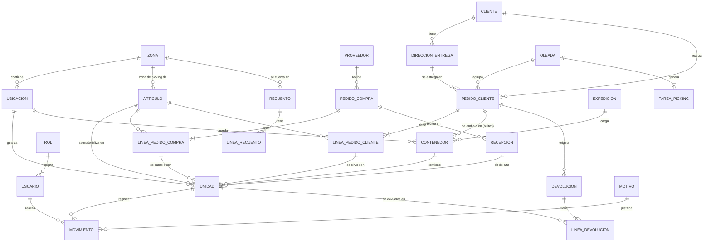

# 02 · Modelo de datos

_Versión 0.1 · 2026-11-23 · Estado: **propuesta, pendiente de validar** por el responsable funcional (Issue #2)._

Este documento describe el **modelo lógico**: qué información guarda el SGA y cómo se relaciona.
Los nombres de entidades y campos están en español y en `snake_case` para facilitar la lectura.
Los nombres físicos de tablas y columnas se fijarán con el ADR de idioma del código y el de tecnología (Issue #5).

## 1. Principios del modelo

1. **Cada unidad física es un registro.** Todos los artículos llevan número de serie y se registra al recibir,
   por lo que el stock no se guarda como «cantidad en una ubicación», sino que se **calcula contando unidades**
   (ver [ADR 0002](03-decisiones/0002-trazabilidad-por-unidad-serializada.md)).
2. **El número de serie es único en todo el almacén**, sea cual sea el artículo.
3. **Todo movimiento queda registrado y no se puede modificar ni borrar.** Si algo se hace mal, se corrige con
   otro movimiento (ver [ADR 0003](03-decisiones/0003-historico-de-movimientos-inmutable.md)).
4. **Las reglas importantes se garantizan en la base de datos** (claves únicas, relaciones obligatorias,
   restricciones), no solo en la aplicación.
5. **Nada se borra físicamente** en los maestros: artículos, ubicaciones, clientes, etc. se desactivan (`activo = no`)
   para no romper el histórico.
6. **Preparado para el ERP sin depender de él:** las entidades que puedan venir del ERP llevan un `codigo_erp`
   opcional (Issue #3).

## 2. Mapa de entidades

| Bloque | Entidades |
|---|---|
| Maestros | Artículo · Zona · Ubicación · Proveedor · Cliente · Dirección de entrega · Usuario · Rol · Motivo |
| Stock | Unidad (número de serie) · Contenedor · Movimiento |
| Entradas | Pedido de compra · Línea de pedido de compra · Recepción |
| Salidas | Pedido de cliente · Línea de pedido de cliente · Oleada · Tarea de picking · Expedición |
| Devoluciones | Devolución · Línea de devolución |
| Inventario | Recuento · Línea de recuento |

## 3. Diagrama entidad-relación

## 4. Entidades

Convenciones de todas las entidades (no se repiten en cada tabla):
`id` (identificador interno), `creado_en`, `creado_por`, `modificado_en`, `modificado_por`.
**Ob.** = obligatorio. **Único** = no puede repetirse.

### 4.1 Maestros

#### Artículo
Referencia gestionada en el almacén (~4.000). Un pack (p. ej. «pack de 6 tubos de PVC marrones») es **un único artículo**,
y cada variante (otro color, otra medida) es **otro artículo** con su propio código de barras.

| Campo | Tipo | Ob. | Notas |
|---|---|---|---|
| codigo | texto | Sí | **Único.** Referencia interna. |
| descripcion | texto | Sí | |
| codigo_barras | texto | Sí | **Único.** Un código de barras por artículo. |
| elementos_por_unidad | entero | No | Informativo: nº de piezas del pack (p. ej. 6). Por defecto 1. |
| peso_kg | decimal | No | Peso de una unidad. |
| largo_cm, ancho_cm, alto_cm | decimal | No | Dimensiones de una unidad. |
| zona_picking_id | → Zona | No | Zona donde se prepara este artículo. |
| codigo_erp | texto | No | Único si existe. |
| activo | sí/no | Sí | |

#### Zona
Área del almacén. Los tipos exactos están **pendientes** (pregunta 9); se proponen estos:
`recepcion`, `picking`, `reserva`, `expedicion`, `muelle`, `cuarentena`, `devoluciones`.

| Campo | Tipo | Ob. | Notas |
|---|---|---|---|
| codigo | texto | Sí | **Único.** P. ej. `A`, `REC`, `EXP`. |
| nombre | texto | Sí | |
| tipo | lista | Sí | Ver lista anterior. |
| activa | sí/no | Sí | |

#### Ubicación
Hueco físico identificado. Esquema: **zona → pasillo → estantería → nivel → hueco**.
Un hueco puede contener **varios artículos distintos**. No se controla su capacidad: solo qué hay.

| Campo | Tipo | Ob. | Notas |
|---|---|---|---|
| zona_id | → Zona | Sí | |
| pasillo, estanteria, nivel, hueco | texto | No | Vacíos en ubicaciones de suelo o de muelle. |
| codigo | texto | Sí | **Único.** P. ej. `A-03-12-2-1`. Es lo que se imprime y escanea. |
| codigo_barras | texto | No | **Único** si existe (por si las etiquetas no usan el mismo código). |
| bloqueada | sí/no | Sí | Bloqueada = no se puede ubicar ni extraer. |
| activa | sí/no | Sí | |

Restricción: la combinación `zona + pasillo + estanteria + nivel + hueco` es única.

#### Proveedor · Cliente
| Campo | Tipo | Ob. | Notas |
|---|---|---|---|
| codigo | texto | Sí | **Único.** |
| nombre | texto | Sí | |
| nif | texto | No | |
| codigo_erp | texto | No | |
| activo | sí/no | Sí | |

#### Dirección de entrega
Un cliente puede tener **varias**.

| Campo | Tipo | Ob. | Notas |
|---|---|---|---|
| cliente_id | → Cliente | Sí | |
| alias | texto | No | P. ej. «Obra Valencia». |
| direccion, codigo_postal, poblacion, provincia, pais | texto | Sí | `pais` por defecto ES. |
| contacto, telefono | texto | No | |
| codigo_erp | texto | No | |
| activa | sí/no | Sí | |

#### Usuario · Rol
Los perfiles concretos están **pendientes** (pregunta 29). Se modelan como catálogo editable.

| Usuario | Tipo | Ob. | Notas |
|---|---|---|---|
| login | texto | Sí | **Único.** |
| nombre | texto | Sí | |
| rol_id | → Rol | Sí | |
| activo | sí/no | Sí | |

Rol: `codigo` (**único**), `nombre`. Los permisos de cada rol se definirán con la tecnología.

#### Motivo
Catálogo de motivos para ajustes, bloqueos, cambios de estado y devoluciones.

| Campo | Tipo | Ob. | Notas |
|---|---|---|---|
| ambito | lista | Sí | `ajuste`, `bloqueo`, `devolucion`, `recuento`. |
| codigo | texto | Sí | Único dentro del ámbito. |
| descripcion | texto | Sí | |
| activo | sí/no | Sí | |

### 4.2 Stock

#### Unidad (número de serie)
**Una fila por cada unidad física** que entra en el almacén. Es el núcleo de la trazabilidad.

| Campo | Tipo | Ob. | Notas |
|---|---|---|---|
| numero_serie | texto | Sí | **Único en todo el almacén.** |
| origen_serie | lista | Sí | `fabricante` (se escanea) o `generado` (lo crea el SGA y se etiqueta). |
| articulo_id | → Artículo | Sí | No cambia nunca. |
| situacion | lista | Sí | Ciclo de vida: `en_almacen`, `preparada`, `expedida`, `baja`. |
| estado | lista | Sí | Calidad / disponibilidad: `disponible`, `bloqueada`, `cuarentena`, `danada`. |
| ubicacion_id | → Ubicación | Cond. | Dónde está, si está suelta. |
| contenedor_id | → Contenedor | Cond. | Dónde está, si está dentro de un palet, caja o bulto. |
| recepcion_id | → Recepción | Sí | Por qué entrada llegó. |
| linea_pedido_compra_id | → Línea pedido compra | Sí | Qué línea de compra cumple. |
| linea_pedido_cliente_id | → Línea pedido cliente | No | Se rellena **al hacer el picking** (qué pedido se lleva esta unidad). |

Reglas:
- Mientras `situacion` = `en_almacen` o `preparada`, la unidad está **o** en una ubicación **o** en un contenedor, nunca en los dos ni en ninguno.
  Si está en un contenedor, su ubicación es la del contenedor (no se guarda dos veces, para que no puedan contradecirse).
- Con `situacion` = `expedida` o `baja`, no tiene ubicación ni contenedor.
- **Reservado** no es un estado de la unidad: la reserva se hace por cantidad (ver «Reservas» en el apartado 5).

#### Contenedor
Palet, caja o bulto con etiqueta propia (matrícula o SSCC) que permite mover todo su contenido de un solo escaneo.
Los **bultos de expedición** son contenedores de tipo `bulto` asociados a un pedido.

| Campo | Tipo | Ob. | Notas |
|---|---|---|---|
| codigo | texto | Sí | **Único.** Matrícula o SSCC. |
| tipo | lista | Sí | `palet`, `caja`, `bulto`. |
| ubicacion_id | → Ubicación | Cond. | Obligatoria mientras esté en el almacén. |
| pedido_cliente_id | → Pedido cliente | Cond. | Obligatorio si `tipo` = `bulto`. |
| expedicion_id | → Expedición | No | Se rellena al cargar el bulto. |
| peso_kg | decimal | No | Útil para la etiqueta del transportista. |
| estado | lista | Sí | `abierto`, `cerrado`, `expedido`, `deshecho`. |

#### Movimiento
Histórico **inmutable** de todo lo que le pasa a cada unidad. Solo se añaden filas; nunca se modifican ni se borran.

| Campo | Tipo | Ob. | Notas |
|---|---|---|---|
| fecha_hora | fecha-hora | Sí | |
| usuario_id | → Usuario | Sí | Quién lo hizo. |
| tipo | lista | Sí | `recepcion`, `ubicacion`, `traslado`, `reposicion`, `picking`, `embalaje`, `expedicion`, `devolucion`, `cambio_estado`, `ajuste_alta`, `ajuste_baja`. |
| unidad_id | → Unidad | Sí | |
| desde_ubicacion_id / hasta_ubicacion_id | → Ubicación | No | |
| desde_contenedor_id / hasta_contenedor_id | → Contenedor | No | |
| estado_anterior / estado_nuevo | lista | No | Solo en cambios de estado. |
| documento_tipo / documento_id | texto / id | No | Documento origen: recepción, pedido, oleada, devolución, recuento… |
| motivo_id | → Motivo | Cond. | Obligatorio en ajustes y cambios de estado. |
| observaciones | texto | No | |

Mover un palet entero genera un movimiento por cada unidad que contiene, todos con el mismo documento.

### 4.3 Entradas

#### Pedido de compra · Línea de pedido de compra
Se recibe **siempre contra pedido**. Un pedido puede recibirse en **varias recepciones** (entregas parciales).

| Pedido de compra | Tipo | Ob. | Notas |
|---|---|---|---|
| numero | texto | Sí | **Único.** |
| proveedor_id | → Proveedor | Sí | |
| fecha_prevista | fecha | No | |
| estado | lista | Sí | `pendiente`, `parcial`, `completo`, `cerrado`, `cancelado`. |
| codigo_erp | texto | No | |

| Línea de pedido de compra | Tipo | Ob. | Notas |
|---|---|---|---|
| pedido_compra_id | → Pedido compra | Sí | |
| numero_linea | entero | Sí | Único dentro del pedido. |
| articulo_id | → Artículo | Sí | |
| cantidad_pedida | entero | Sí | > 0 |

La **cantidad recibida** no se guarda: es el número de unidades asociadas a la línea.

#### Recepción
Cada llegada física de mercancía de un pedido. Sin control de calidad: lo recibido queda `disponible`.

| Campo | Tipo | Ob. | Notas |
|---|---|---|---|
| numero | texto | Sí | **Único.** |
| pedido_compra_id | → Pedido compra | Sí | |
| albaran_proveedor | texto | No | |
| fecha_hora_inicio / fecha_hora_fin | fecha-hora | Sí / No | |
| estado | lista | Sí | `en_curso`, `cerrada`. |

### 4.4 Salidas

#### Pedido de cliente · Línea de pedido de cliente
Un pedido **no sale hasta estar completo** (no hay envíos parciales).

| Pedido de cliente | Tipo | Ob. | Notas |
|---|---|---|---|
| numero | texto | Sí | **Único.** |
| cliente_id | → Cliente | Sí | |
| direccion_entrega_id | → Dirección | Sí | Debe pertenecer al mismo cliente. |
| fecha_pedido / fecha_servicio | fecha | Sí / No | |
| oleada_id | → Oleada | No | |
| estado | lista | Sí | Ver ciclo más abajo. |
| codigo_erp | texto | No | |

Ciclo del pedido: `pendiente` (sin stock suficiente) → `liberado` (todo su stock reservado) → `en_preparacion`
→ `preparado` → `expedido`. En cualquier momento antes de expedir: `cancelado`.

| Línea de pedido de cliente | Tipo | Ob. | Notas |
|---|---|---|---|
| pedido_cliente_id | → Pedido cliente | Sí | |
| numero_linea | entero | Sí | Único dentro del pedido. |
| articulo_id | → Artículo | Sí | |
| cantidad | entero | Sí | > 0 |

La **cantidad preparada** no se guarda: es el número de unidades con esa línea asignada.

#### Oleada
Agrupación de varios pedidos para prepararlos en una misma ronda de picking.

| Campo | Tipo | Ob. | Notas |
|---|---|---|---|
| codigo | texto | Sí | **Único.** |
| estado | lista | Sí | `abierta`, `en_curso`, `terminada`, `cancelada`. |

#### Tarea de picking
Trabajo concreto que se encarga a un operario dentro de una oleada: «coge N unidades del artículo X en la ubicación Y».

| Campo | Tipo | Ob. | Notas |
|---|---|---|---|
| oleada_id | → Oleada | Sí | |
| articulo_id | → Artículo | Sí | |
| ubicacion_id | → Ubicación | Sí | Ubicación sugerida. |
| cantidad | entero | Sí | > 0 |
| usuario_id | → Usuario | No | Operario asignado. |
| estado | lista | Sí | `pendiente`, `en_curso`, `hecha`, `incidencia`. |

El operario escanea cada número de serie que coge; en ese momento la unidad queda asignada a la línea del pedido.

#### Expedición
Salida física de uno o varios pedidos completos (p. ej. una carga de camión). Los datos del transporte están **pendientes** (pregunta 23).

| Campo | Tipo | Ob. | Notas |
|---|---|---|---|
| numero | texto | Sí | **Único.** |
| fecha_hora | fecha-hora | Sí | |
| transportista | texto | No | Pasará a ser un maestro si se confirma que hace falta. |
| numero_seguimiento | texto | No | |
| estado | lista | Sí | `en_carga`, `expedida`. |

### 4.5 Devoluciones

#### Devolución · Línea de devolución
Toda devolución va **asociada a un pedido** expedido. Como cada unidad tiene número de serie, se sabe exactamente qué unidad vuelve.

| Devolución | Tipo | Ob. | Notas |
|---|---|---|---|
| numero | texto | Sí | **Único.** |
| pedido_cliente_id | → Pedido cliente | Sí | El cliente es el del pedido. |
| fecha_hora | fecha-hora | Sí | |
| estado | lista | Sí | `en_curso`, `cerrada`. |

| Línea de devolución | Tipo | Ob. | Notas |
|---|---|---|---|
| devolucion_id | → Devolución | Sí | |
| unidad_id | → Unidad | Sí | Debe haber salido en ese pedido. |
| motivo_id | → Motivo | No | Pendiente de confirmar si es obligatorio (pregunta 26). |
| destino | lista | No | Pendiente (pregunta 26). Propuesta: `stock`, `cuarentena`, `proveedor`, `desecho`. |

### 4.6 Inventario

#### Recuento · Línea de recuento
Recuentos **cíclicos por zonas**. Se escanea cada número de serie encontrado en cada ubicación y el sistema lo compara con lo esperado.

| Recuento | Tipo | Ob. | Notas |
|---|---|---|---|
| zona_id | → Zona | Sí | |
| fecha_hora_inicio / fecha_hora_fin | fecha-hora | Sí / No | |
| estado | lista | Sí | `abierto`, `pendiente_revision`, `cerrado`. |

| Línea de recuento | Tipo | Ob. | Notas |
|---|---|---|---|
| recuento_id | → Recuento | Sí | |
| ubicacion_id | → Ubicación | Sí | |
| numero_serie_leido | texto | No | Lo que se escaneó. |
| unidad_id | → Unidad | No | Unidad esperada o encontrada. |
| resultado | lista | Sí | `correcta`, `no_encontrada`, `mal_ubicada`, `desconocida`. |

Al cerrar el recuento, las diferencias aprobadas generan movimientos de `traslado` o de ajuste, con su motivo.

## 5. Reglas de negocio que recoge el modelo

- **Stock** = unidades con `situacion = en_almacen`, agrupadas por artículo, ubicación (directa o vía contenedor) y estado.
- **Reservas.** Como un pedido no sale incompleto, se reserva **todo o nada**: un pedido pasa a `liberado` solo si,
  para cada línea, hay unidades disponibles suficientes.
  Stock libre de un artículo = unidades `disponibles` en almacén sin pedido asignado − cantidades pendientes de coger
  de los pedidos `liberados` o `en_preparacion`.
  No se reserva un número de serie concreto: el operario coge cualquier unidad válida y la serie se asigna al escanearla
  (más ágil y sin bloqueos cuando una unidad concreta no aparece).
- **Recepción contra pedido**: cada unidad recibida apunta a una línea del pedido de compra. Una línea no puede recibir
  más unidades de las pedidas (ver supuesto S5).
- **Picking por zona**: cada artículo tiene una zona de picking; dentro de la zona puede estar en cualquier hueco (ver supuesto S4).
- **Devoluciones**: solo pueden devolverse unidades que salieron en el pedido indicado; al recibirse, la unidad vuelve a
  `en_almacen` en la zona de devoluciones.
- **Bajas y ajustes** siempre con usuario, fecha y motivo.

## 6. Supuestos (a confirmar)

| # | Supuesto | Si no fuera así |
|---|---|---|
| S1 | El número de serie puede venir del fabricante **o** generarlo el SGA (campo `origen_serie`). | El modelo ya admite ambos; solo cambia el proceso de recepción. |
| S2 | Un pack (p. ej. 6 tubos) se maneja **siempre entero** y tiene **un único** número de serie. | Habría que modelar la apertura de packs y series por pieza. |
| S3 | Cada variante (color, medida) es **un artículo distinto** con su propio código de barras. | Se añadiría una entidad de variantes por artículo. |
| S4 | Cada artículo tiene asignada una **zona** de picking y dentro de ella se guarda en **cualquier hueco libre**. | Se añadiría un hueco fijo por artículo y la reposición desde reserva. |
| S5 | No se admite recibir **más** unidades de las pedidas ni artículos que no estén en el pedido. | Se permitiría con aviso y se registraría como excedente. |
| S6 | Un pedido de cliente se entrega en **una sola** dirección. | La dirección pasaría a cada línea. |

## 7. Pendiente de información

| Pregunta | Tema | Cómo queda en el modelo |
|---|---|---|
| 9 | Tipos de zona del almacén | Lista provisional en Zona. |
| 20 | Origen y volumen de los pedidos de cliente | `codigo_erp` opcional; volumen necesario para dimensionar. |
| 23 | Embalaje, etiquetas y transportistas | Bultos como contenedores; transportista como texto libre. |
| 26 | Destinos y motivos de devolución | Campos opcionales con valores propuestos. |
| 29 | Perfiles de usuario | Rol como catálogo editable. |
| 30 | ERP y quién es dueño de cada dato | `codigo_erp` opcional en artículos, terceros y pedidos (Issue #3). |
| — | Número de ubicaciones | No afecta al diseño; necesario para la carga inicial. |
